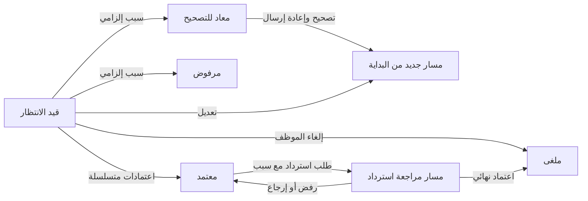

# الخدمات الذاتية للموظفين والمدراء

## النطاق والتكامل

واجهة الموظف: `/employee/requests`. لوحة المسؤول الموجودة: `/approvals?tab=inbox`، والصادر `/approvals?tab=outbox`. تستخدم الواجهة الجديدة محرك الاعتماد نفسه والصلاحيات والإشعارات وسجل التدقيق الموجودين، ولا تنشئ نظام اعتماد موازياً.

الخدمات: الإجازات النشطة المعرفة في قاعدة البيانات (سنوية، مرضية، اضطرارية، بدون راتب، خروج وعودة أو غيرها)، المباشرة، الخطابات وتعريف الراتب، السلف، المصروفات، العمل الإضافي، الوثائق، الإقامة، الانتداب والعهد، وطلبات بدل السكن والانتقال وإذن الخروج وتصفية المستحقات وتحديث البيانات. الخدمات الإدارية العامة تحفظ تفاصيل الطلب في `LetterRequest.purpose`؛ اعتمادها يمثل قراراً إدارياً، ولا ينفذ دفعاً أو يعدل بيانات الهوية آلياً. القروض المعتمدة تحتاج تسوية مالية منفصلة، ولا يعكسها زر الاسترداد.

أنواع الإجازات تؤخذ من `LeaveType` الفعّال بدلاً من إنشاء أنواع وهمية أو استبدال نوع غير موجود. عدّل أنواع الإجازات عبر إدارة النظام حسب سياسة المنشأة.

## مخطط قاعدة البيانات

المشروع لديه جداول متخصصة؛ `requests` و`approval_workflows` مفهومان منطقيان يقابلهما التالي، مع إبقاء أسماء جداول Prisma الحالية للتوافق:

| المفهوم | جدول المشروع | الحقول الأساسية |
| --- | --- | --- |
| الطلب | `LeaveRequest` / `ResumptionRequest` / `Loan` / `ExpenseRequest` / `OvertimeRequest` / `LetterRequest` | `id`, `employeeId`, بيانات الخدمة, `status`, `createdAt`, `updatedAt` |
| مسار الطلب | `WorkflowInstance` | `id`, `employeeId`, `type`, `entityId`, `status`, `currentStep`, `createdAt`, `updatedAt` |
| مراحل الاعتماد | `WorkflowStep` | `workflowInstanceId`, `step`, `approverUserId`, `status`, `approvedAt`, `viewedAt`, `comments`, `capabilities` |
| سجل القرارات | `AuditLog` | `actorUserId`, `action`, `entity`, `entityId`, `metadata`, `createdAt` |
| الرصيد | `EmployeeLeaveBalance` | `employeeId`, `accrued`, `used` |

الحالات المنطقية `pending`, `approved`, `rejected`, `cancelled`, `returned` تقابل `PENDING`, `COMPLETED`, `REJECTED`, `CANCELLED`, `RETURNED` في مسار الاعتماد. السجل المتخصص يصبح `APPROVED` عند اكتمال المسار (القرض يصبح `ACTIVE`). عند الإرجاع يظل السجل المتخصص `PENDING`، والمسار هو مصدر حالة `RETURNED`. النسخ السابقة من المسار تصبح `SUPERSEDED` وتبقى للتدقيق.

الترحيل `202611050001_self_service_lifecycle` يضيف فهارس للموظف والحالة والتاريخ، ولنوع الطلب ومرجعه، وفهرساً فريداً جزئياً يمنع وجود طلبي استرداد معلقين لنفس المسار. شرط الفهرس الجزئي محفوظ في SQL لأن Prisma لا يمثل هذا الشرط في المخطط.



## مصفوفة الصلاحيات والمسارات

- صاحب الطلب وحده يقدم ويعدل ويلغي؛ يؤخذ الموظف من الجلسة، ولا يثق الخادم في `employeeId` الوارد من العميل.
- التعديل للطلب المعلق فقط. الطلب المعاد له إجراء مستقل `RESUBMIT` للتصحيح وإعادة الإرسال.
- كل تعديل يعيد المسار من البداية؛ يحتفظ بسجل قرارات النسخة السابقة، ولا ينقل موافقة على بيانات قديمة إلى بيانات جديدة.
- الاعتماد والرفض والإرجاع للمعتمد المكلّف بالمرحلة الحالية وفق `capabilities`، مع منع الموافقة الذاتية. الرفض والإرجاع يتطلبان سبباً.
- التحويل متاح عبر لوحة الاعتماد الحالية، ولا يجوز تحويل الطلب إلى صاحبه أو حساب غير نشط.
- المسارات قابلة للتكوين حسب الشركة/المستشفى/الإدارة/الفرع/المشروع عبر `/api/enterprise/request-routing` و`/api/enterprise/approval-paths`. لتسلسل **المباشر → مدير الإدارة → HR → النهائي**، اضبط مساراً بأربع مراحل إلزامية بأسماء المعتمدين الفعليين. الإعداد الافتراضي الحالي للمستودع (المدير ثم HR، أو HR لبعض الخدمات) لم يُستبدل دون معرفة هيكل المنشأة. لا توجد أسماء معتمدين مصطنعة.
- الاسترداد يحل مسار الخدمة الأصلي من الإعدادات الحالية ويأخذ لقطة للمعتمدين، ثم ينتظر اعتمادهم. الرفض أو الإرجاع لا يغير الطلب الأصلي. يمكن تقديم طلب استرداد جديد بعد رفض/إرجاع السابق.

## واجهات API

| الطريقة والمسار | الاستخدام |
| --- | --- |
| `POST /api/hr/my-requests` | تقديم الخدمة؛ عقد التقديم الموجود، مثل `{type:"LEAVE",leaveType:"ANNUAL",startDate:"2027-01-01",endDate:"2027-01-03",reason:"..."}` |
| `GET /api/self-service?page=1` | طلبات صاحب الجلسة، 20 في الصفحة، والأنواع النشطة للإجازات |
| `GET /api/self-service/:workflowId` | بيانات طلب المالك لتعبئة نموذج التعديل |
| `POST /api/self-service/:workflowId` | إجراء دورة الحياة أدناه |
| `GET /api/enterprise/workflows/:id` | البيانات والمراحل وأسماء المعتمدين وتوقيتها وسجل العمليات حسب نطاق الوصول |
| `POST /api/enterprise/workflows/:id/decision` | `{decision:"APPROVE"\|"REJECT"\|"RETURN"\|"TRANSFER",comments?,targetUserId?}` |

أمثلة دورة الحياة:

```json
{"action":"EDIT","data":{"startDate":"2027-01-01","endDate":"2027-01-03","reason":"تحديث"}}
```

```json
{"action":"RESUBMIT","data":{"purpose":"تفاصيل مصححة"}}
```

```json
{"action":"CANCEL"}
```

```json
{"action":"REVOKE","reason":"تغير موعد السفر"}
```

التعديل يقبل حقولاً محددة فقط؛ يرفض حقن المالك أو الحالة والمبالغ غير الموجبة والتواريخ غير الصحيحة. عدد أيام الإجازة يحسب على الخادم بالأيام التقويمية شاملاً يومي البداية والنهاية، وفق السلوك الحالي للمشروع. تغيير نوع الخدمة/الإجازة ليس جزءاً من التعديل؛ ألغ الطلب وقدم النوع الصحيح.

الاستجابات: 401 للجلسة المفقودة، 404 لطلب الغير، 400 للبيانات غير الصالحة، 409 لتعارض الحالة. لا يوجد حذف نهائي لسجل الطلب؛ الإلغاء هو الحذف المنطقي مع الاحتفاظ بالتدقيق.

## التأثير الآلي والتزامن

الاعتماد النهائي للإجازة السنوية يزيد `used` مرة واحدة داخل معاملة القرار نفسها. الإجازات الخاصة والمرضية لا تخصم من الإجمالي السنوي. تقارير الغياب والتقويم تعتمد على `LeaveRequest.status=APPROVED`، وبالتالي ترى الاعتماد والإلغاء مباشرة؛ لا تُطمس بصمات الحضور الخام بكتابة حضور مصطنع.

الاسترداد لا يعيد الرصيد عند تقديمه. عند اعتماده النهائي، تُلغى الإجازة والمسار الأصلي ويعاد الرصيد السنوي في المعاملة نفسها. يمنع تكرار الاعتماد أو إعادة الرصيد. الطلب الإضافي المدرج في الرواتب لا يلغى دون تصحيح مالي. تحديث المسار المشروط بالحالة والمرحلة و`updatedAt` يمنع نجاح تعديل الموظف وقرار المسؤول معاً على النسخة القديمة.

## التحقق والتشغيل

```sh
npx prisma generate
npm run typecheck
npm run build
node --experimental-vm-modules tests/workflows/self-service.test.mjs
```

اختبار التكامل `tests/workflows/self-service.integration.mjs` يحتاج قاعدة PostgreSQL محلية مستقلة ينتهي اسمها بـ `_test`، بمخطط متزامن. يختبر ملكية الطلب والتعديل والإرجاع وإعادة الإرسال وأربع مراحل واعتمادين متزامنين وخصم الرصيد والاسترداد ومنع التكرار، ثم ينظف بياناته:

```sh
SELF_SERVICE_TEST_DATABASE_URL='postgresql://…@localhost:5432/lana_self_service_test' node --experimental-vm-modules tests/workflows/self-service.integration.mjs
```

تطبيق ترحيلات المستودع على قاعدة فارغة نجح، لكن كشف اختبار التكامل نقص حقل `User.sidebarHue` من الترحيلات القديمة مقارنة بالمخطط الحالي. استُخدم `prisma db push` فقط على قاعدة الاختبار المعزولة لاستكمال الاختبار؛ يلزم فحص انحراف مخطط بيئة النشر قبل الترحيل، وليس تشغيل `db push` عليها تلقائياً. لم تُطبّق تغييرات على قاعدة إنتاج ولم يحدث نشر.
